<picture>
  <source media="(prefers-reduced-motion: reduce) and (max-width: 600px)" srcset="docs/readme/hero-mobile.svg">
  <source media="(prefers-reduced-motion: reduce)" srcset="docs/readme/hero.svg">
  <source media="(max-width: 600px)" srcset="docs/readme/motion/hero-mobile.svg">
  
</picture>

Асинхронный Telegram-бот для публикаций в каналы, шаблонов постов и проверки подписки. Список каналов и пагинация работают через локальную SQLite; дополнительно есть Mini App.

<picture>
  <source media="(prefers-reduced-motion: reduce)" srcset="docs/readme/stack/tech-1.svg">
  
</picture>
<picture>
  <source media="(prefers-reduced-motion: reduce)" srcset="docs/readme/stack/tech-2.svg">
  
</picture>
<picture>
  <source media="(prefers-reduced-motion: reduce)" srcset="docs/readme/stack/tech-3.svg">
  
</picture>
<picture>
  <source media="(prefers-reduced-motion: reduce)" srcset="docs/readme/stack/tech-4.svg">
  
</picture>
<picture>
  <source media="(prefers-reduced-motion: reduce)" srcset="docs/readme/stack/tech-5.svg">
  
</picture>
<picture>
  <source media="(prefers-reduced-motion: reduce)" srcset="docs/readme/stack/tech-6.svg">
  
</picture>

<h2 id="возможности">
<picture>
  <source media="(prefers-reduced-motion: reduce) and (max-width: 600px)" srcset="docs/readme/headings/section-1-mobile.svg">
  <source media="(prefers-reduced-motion: reduce)" srcset="docs/readme/headings/section-1.svg">
  <source media="(max-width: 600px)" srcset="docs/readme/motion/headings/section-1-mobile.svg">
  
</picture>
</h2>

- Добавление канала пересылкой сообщения и быстрый режим добавления.
- Подготовка текста и медиа, предварительный просмотр и публикация.
- Сохранение шаблонов и повторное использование постов.
- Подписочная кнопка с проверкой участия пользователя в канале.
- Фоновая проверка прав, статистика и локальная пагинация.
- Mini App для выбора каналов, обзора и шаблонов.

Панель управления доступна администраторам из локального файла ID; изменения файла перечитываются во время работы.

<h2 id="запуск">
<picture>
  <source media="(prefers-reduced-motion: reduce) and (max-width: 600px)" srcset="docs/readme/headings/section-2-mobile.svg">
  <source media="(prefers-reduced-motion: reduce)" srcset="docs/readme/headings/section-2.svg">
  <source media="(max-width: 600px)" srcset="docs/readme/motion/headings/section-2-mobile.svg">
  
</picture>
</h2>

Нужен Python 3.11+ и токен бота. Linux/macOS:

```bash
git clone https://github.com/Kriksson/dtv-bot.git
cd dtv-bot
python3 -m venv .venv
source .venv/bin/activate
python -m pip install -r requirements.txt
cp .env.example .env
```

Настройте `.env`:

```dotenv
BOT_TOKEN=your_bot_token
ADMINS_FILE=admins.txt
DATABASE_PATH=dtv_bot.sqlite3
FAST_ADD_TIMEOUT_SECONDS=120
WEBAPP_URL=
WEBAPP_PORT=8080
```

Создайте `admins.txt`: один числовой Telegram ID администратора на строку. Это текущий механизм доступа; переменная `ADMIN_USER_IDS` в коде не используется.

```bash
python -m app.main
```

<details>
<summary>Подготовка окружения в Windows PowerShell</summary>

```powershell
py -m venv .venv
.\.venv\Scripts\Activate.ps1
python -m pip install -r requirements.txt
Copy-Item .env.example .env
notepad .env
```

Далее настройте `ADMINS_FILE`, создайте файл ID и запустите `python -m app.main`.

</details>

Бот должен быть администратором каждого канала, в котором публикует сообщения. Для подписочной кнопки также нужен доступ к проверке участников.

<h2 id="mini-app-и-конфигурация">
<picture>
  <source media="(prefers-reduced-motion: reduce) and (max-width: 600px)" srcset="docs/readme/headings/section-3-mobile.svg">
  <source media="(prefers-reduced-motion: reduce)" srcset="docs/readme/headings/section-3.svg">
  <source media="(max-width: 600px)" srcset="docs/readme/motion/headings/section-3-mobile.svg">
  
</picture>
</h2>

Локальный HTTP-сервер запускается вместе с ботом на `127.0.0.1:WEBAPP_PORT`. Для использования Mini App в Telegram задайте свой внешний HTTPS-адрес в `WEBAPP_URL` и настройте проксирование к этому серверу.

| Переменная | Назначение |
| --- | --- |
| `BOT_TOKEN` | Токен Telegram-бота |
| `ADMINS_FILE` | Путь к файлу разрешённых ID |
| `DATABASE_PATH` | Файл SQLite |
| `FAST_ADD_TIMEOUT_SECONDS` | Время сессии быстрого добавления |
| `TELEGRAM_PROXY` | Необязательный адрес прокси |
| `WEBAPP_URL`, `WEBAPP_PORT` | Адрес Mini App и локальный порт |

Примеры для сервиса Linux находятся в [deploy](deploy). Пути в `dtv-bot.service` и `runtime.env.example` нужно согласовать со своей установкой.

<h2 id="почему-интерфейс-быстрый">
<picture>
  <source media="(prefers-reduced-motion: reduce) and (max-width: 600px)" srcset="docs/readme/headings/section-4-mobile.svg">
  <source media="(prefers-reduced-motion: reduce)" srcset="docs/readme/headings/section-4.svg">
  <source media="(max-width: 600px)" srcset="docs/readme/motion/headings/section-4-mobile.svg">
  
</picture>
</h2>

Открытие списка и переключение страниц читают SQLite. Telegram API используется для операций, которым нужны актуальные сведения Telegram: добавления канала, проверки прав, публикации и проверки подписки.

<h2 id="структура">
<picture>
  <source media="(prefers-reduced-motion: reduce) and (max-width: 600px)" srcset="docs/readme/headings/section-5-mobile.svg">
  <source media="(prefers-reduced-motion: reduce)" srcset="docs/readme/headings/section-5.svg">
  <source media="(max-width: 600px)" srcset="docs/readme/motion/headings/section-5-mobile.svg">
  
</picture>
</h2>

```text
app/main.py       обработчики бота и HTTP-сервер Mini App
app/config.py     переменные окружения и реестр администраторов
app/database.py   работа с SQLite
app/webapp/       интерфейс Mini App
deploy/           примеры systemd и конфигурации
```
